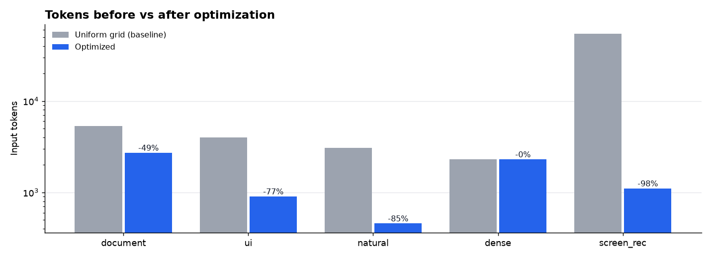
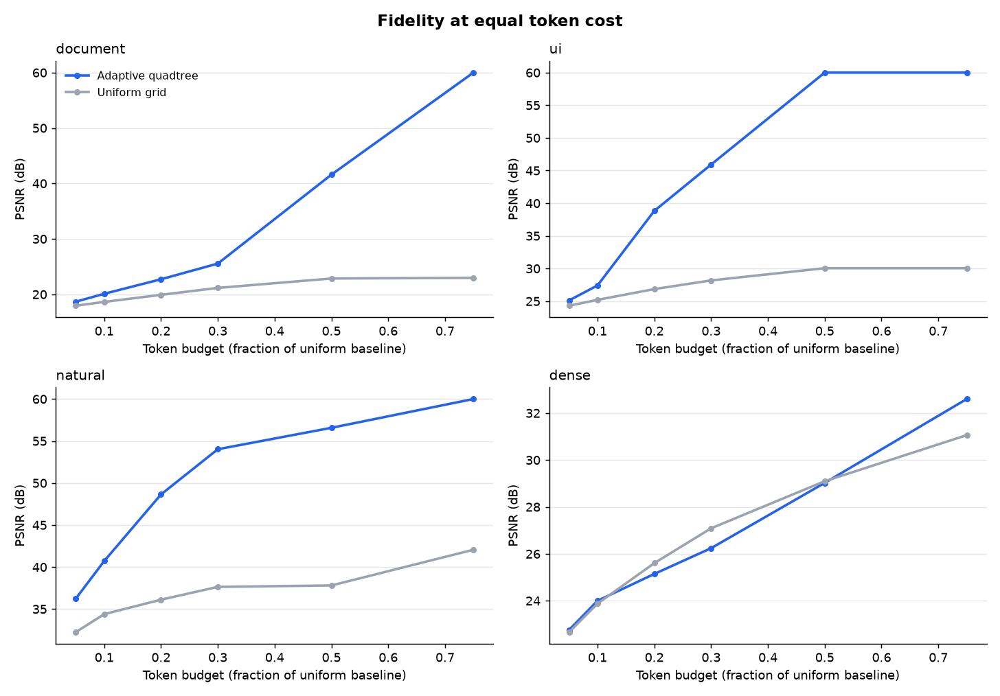
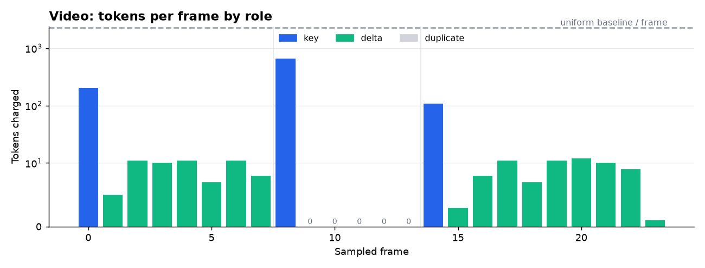

# Adaptive Multimodal Token Optimizer - evaluation report

Patch size **16px**, variance threshold **40.0**. Baseline = uniform patch grid (one token per patch), the allocation a standard ViT-style encoder makes regardless of content.

## Images

| input | size | baseline tok | optimized tok | reduction | PSNR | SSIM | uniform@same-budget PSNR / SSIM | time |
|---|---|---:|---:|---:|---:|---:|---:|---:|
| document | 1024x1320 | 5312 | 2722 | **48.8%** | 70.6 | 1.000 | 23.0 / 0.946 | 232 ms |
| ui | 1280x800 | 4000 | 905 | **77.4%** | 42.8 | 0.979 | 27.2 / 0.960 | 106 ms |
| natural | 1024x768 | 3072 | 458 | **85.1%** | 42.3 | 0.977 | 34.6 / 0.984 | 121 ms |
| dense | 768x768 | 2304 | 2304 | **0.0%** | lossless | 1.000 | lossless / 1.000 | 107 ms |

PSNR/SSIM compare the original with what the model would receive (each leaf squeezed into one patch). 'Uniform@same-budget' downsizes the whole image to the same token count - the fair baseline for the allocation decision.

## Video

| input | size | baseline tok | optimized tok | reduction | mean / min PSNR | scenes | key / delta / dup | static overlay blocks | time |
|---|---|---:|---:|---:|---:|---:|---|---:|---:|
| screen_rec | 960x600 x 24 frames | 54720 | 1107 | **98.0%** | 48.1 / 44.8 | 3 | 3 / 16 / 5 | 130 | 2751 ms |

## Claude adapter (estimated)

Overview thumbnail + full-resolution crops of detailed regions. Estimates use `tokens ~ w*h/750` after fitting to a 1568px long edge - an approximation; `count_tokens_with_claude()` gives exact numbers.

| input | full image est. | optimized payload est. | reduction | fallback to original? | preview PSNR |
|---|---:|---:|---:|---|---:|
| document | 1803 | 1467 | 18.6% | no | lossless |
| ui | 1366 | 1366 | 0.0% | yes | lossless |
| natural | 1049 | 587 | 44.0% | no | 55.4 |
| dense | 787 | 787 | 0.0% | yes | lossless |

## Cost framing

Across this run the optimizer removed **61,912 patch tokens**. At $4.00/M input tokens that is $0.2476 per pass over this set - negligible once, but it repeats on every call and every agent turn that re-sends the attachment, while the preprocessing cost is paid once.

## Honest limitations (so far)

* Dense texture gets ~0% reduction by design - nothing is redundant.
* Variance is a conservative split rule: smooth gradients and fine noise both look 'busy'. A detail-energy criterion (variance lost after resampling) is the next step.
* Fidelity is measured as pixel fidelity (PSNR/SSIM). Answer-quality evaluation on a fixed question set against a real vision model is not done yet.
* The synthetic screen recording is a favourable case for temporal reuse; real camera footage will reduce less.
