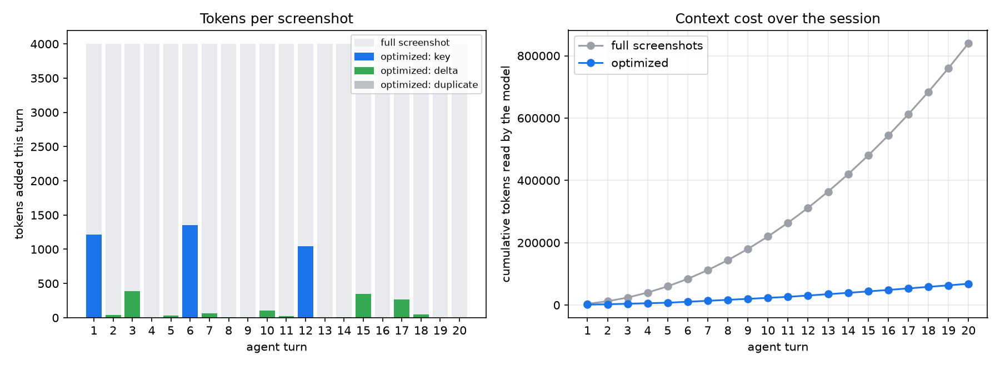
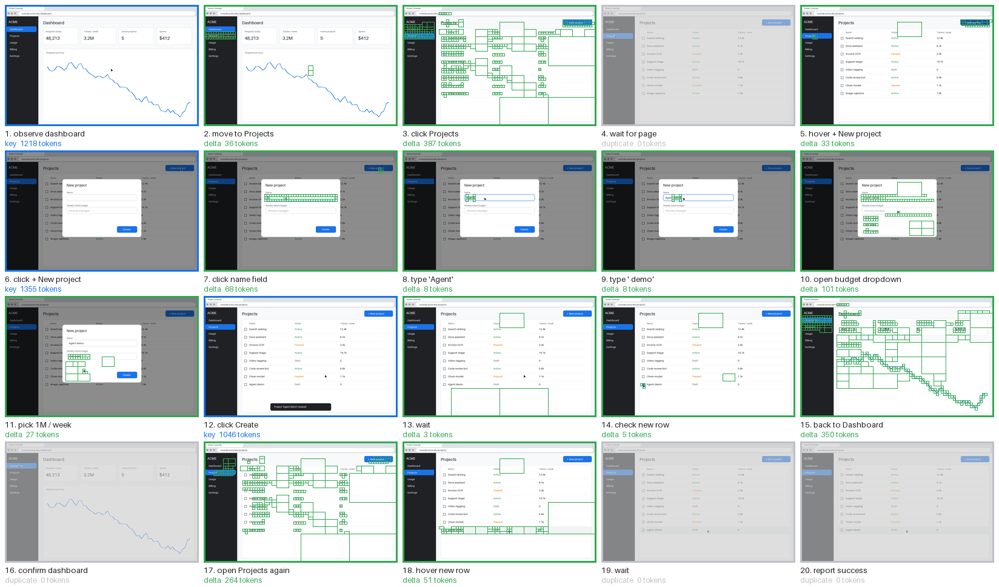

# Agent-screenshot compression

A scripted 20-turn computer-use session at 1280x800, encoded causally (turn k sees only screenshots 1..k). Baseline: the full 16 px patch grid (4,000 tokens) every turn.

| metric | full screenshots | optimized | reduction |
|---|---:|---:|---:|
| screenshot tokens | 80,000 | 4,960 | 93.8% |
| context tokens read (all turns) | 840,000 | 68,178 | 91.9% |

Turn roles: 3 key, 13 delta, 4 duplicate. Lowest reconstruction PSNR: 36.74 dB.

Context tokens assume the agent keeps every screenshot in its history, so turn k re-reads all k images; this is why the saving compounds.

| turn | action | role | tokens | PSNR dB |
|---:|---|---|---:|---:|
| 1 | observe dashboard | key | 1,218 | 42.89 |
| 2 | move to Projects | delta | 36 | 42.8 |
| 3 | click Projects | delta | 387 | 36.85 |
| 4 | wait for page | duplicate | 0 | 36.85 |
| 5 | hover + New project | delta | 33 | 36.74 |
| 6 | click + New project | key | 1,355 | 45.37 |
| 7 | click name field | delta | 68 | 45.69 |
| 8 | type 'Agent' | delta | 8 | 45.3 |
| 9 | type ' demo' | delta | 8 | 42.19 |
| 10 | open budget dropdown | delta | 101 | 41.14 |
| 11 | pick 1M / week | delta | 27 | 44.43 |
| 12 | click Create | key | 1,046 | 39.95 |
| 13 | wait | delta | 3 | 39.53 |
| 14 | check new row | delta | 5 | 39.48 |
| 15 | back to Dashboard | delta | 350 | 38.45 |
| 16 | confirm dashboard | duplicate | 0 | 38.45 |
| 17 | open Projects again | delta | 264 | 37.7 |
| 18 | hover new row | delta | 51 | 37.6 |
| 19 | wait | duplicate | 0 | 37.6 |
| 20 | report success | duplicate | 0 | 37.6 |

Limitation: each turn is re-encoded from its own prefix, so the reference canvas a delta builds on is the one that prefix reconstructs, which can differ slightly from what an earlier turn actually sent when overlay detection changes as history grows.
