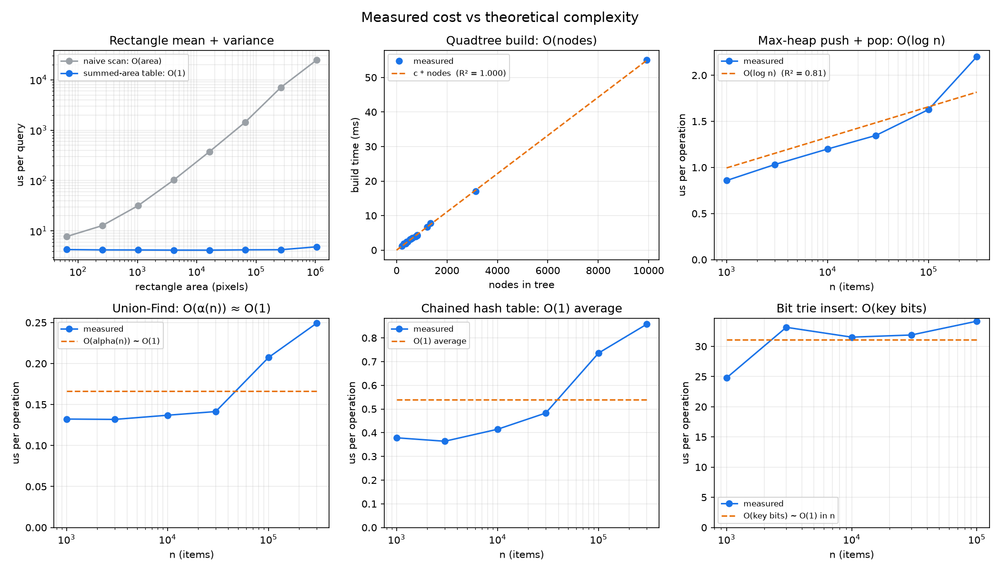

# Empirical complexity

Each structure's core operation is timed over growing inputs (median of repeats) and the theoretical model c * f(n) is fitted with one free constant. For the flat O(1) models R² near 0 is expected (nothing to explain beyond the constant); what matters is that cost per operation stays flat as n grows 300x.

| structure | theory | fitted R² | evidence |
|---|---|---:|---|
| Summed-area table query | O(1) | - | 4.3 us at 64 px vs 4.8 us at 1,048,576 px; naive scan grows 3182x |
| Naive rectangle scan | O(area) | 0.998 | grows with area |
| Quadtree build | O(nodes) | 1.000 | linear in nodes |
| Max-heap push + pop | O(log n) | 0.813 | 0.86 us/op at n=1,000 -> 2.20 us/op at n=300,000 |
| Union-Find | O(α(n)) | - | 0.13 us/op at n=1,000 -> 0.25 us/op at n=300,000 |
| Chained hash table | O(1) average | - | 0.38 us/op at n=1,000 -> 0.86 us/op at n=300,000 |
| Bit trie insert | O(key bits) | - | 24.79 us/op at n=1,000 -> 34.17 us/op at n=100,000 |

**Reading the drift.** Per-operation cost of the heap, union-find and hash table creeps up at the largest n. The operation count does not change; past ~100k items the working set no longer fits in the CPU cache, so each memory access gets slower. This is a hardware effect on top of the asymptotic cost, and it is why the heap fits log n only loosely.

