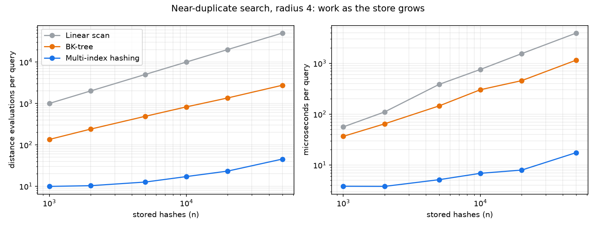
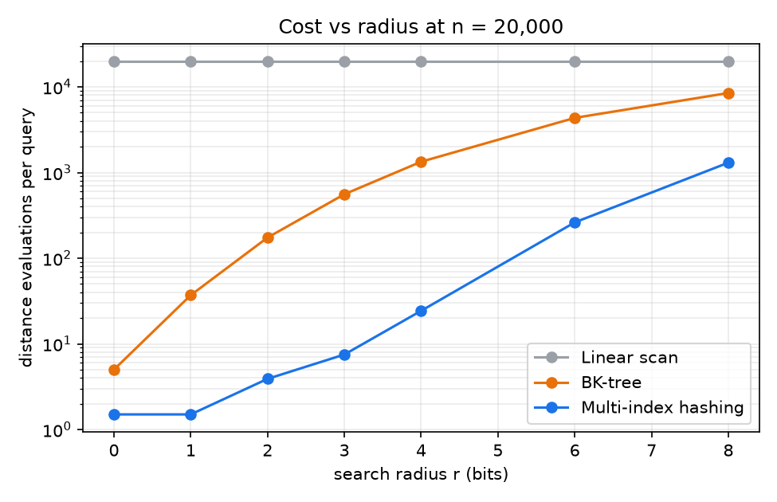

# Near-duplicate search race

Linear scan vs BK-tree vs multi-index hashing on clustered 64-bit pHash signatures, radius 4, 300 queries per point (half near-duplicates, half unrelated). Every answer is checked against linear scan.

| n | linear cmp / us | BK-tree cmp / us | MIH cmp / us | all correct |
|---:|---:|---:|---:|---|
| 1,000 | 1,000.0 / 56.16 | 134.9 / 36.6 | 9.9 / 3.82 | yes |
| 2,000 | 2,000.0 / 110.4 | 239.6 / 64.49 | 10.3 / 3.8 | yes |
| 5,000 | 5,000.0 / 384.64 | 487.7 / 145.25 | 12.6 / 5.15 | yes |
| 10,000 | 10,000.0 / 756.55 | 825.5 / 302.21 | 17.1 / 6.87 | yes |
| 20,000 | 20,000.0 / 1546.95 | 1,355.0 / 455.4 | 23.2 / 7.95 | yes |
| 50,000 | 50,000.0 / 3922.25 | 2,743.8 / 1153.3 | 45.2 / 17.53 | yes |

## Radius sweep at n = 20,000 (distance evaluations per query)

| radius | linear | BK-tree | MIH | avg hits |
|---:|---:|---:|---:|---:|
| 0 | 20,000.0 | 5.0 | 1.5 | 0.26 |
| 1 | 20,000.0 | 37.0 | 1.5 | 0.57 |
| 2 | 20,000.0 | 174.0 | 3.9 | 1.17 |
| 3 | 20,000.0 | 557.6 | 7.5 | 2.15 |
| 4 | 20,000.0 | 1,337.1 | 24.3 | 3.14 |
| 6 | 20,000.0 | 4,345.4 | 261.8 | 5.7 |
| 8 | 20,000.0 | 8,481.6 | 1,302.7 | 8.76 |

