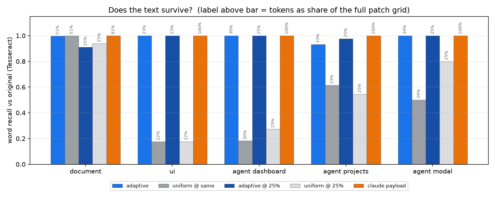

# Does the text survive? (OCR check)

Tesseract 5 (free, local) reads each image as the model would receive it. Word recall = share of the words Tesseract reads in the original that it still reads in the variant. Tokens are on the 16 px patch grid (the Claude payload is converted to the same unit from its pixel-area estimate).

| sample | words | adaptive | uniform @ same | adaptive @ 25% | uniform @ 25% | claude payload |
|---|---:|---:|---:|---:|---:|---:|
| document | 288 | 100% @ 51% | 100% @ 51% | 91% @ 25% | 94% @ 25% | 100% @ 81% |
| ui | 51 | 100% @ 23% | 18% @ 22% | 100% @ 23% | 18% @ 22% | 100% @ 100% |
| agent dashboard | 22 | 100% @ 30% | 18% @ 30% | 100% @ 25% | 27% @ 25% | 100% @ 100% |
| agent projects | 44 | 93% @ 33% | 61% @ 33% | 98% @ 25% | 55% @ 25% | 100% @ 100% |
| agent modal | 10 | 100% @ 34% | 50% @ 34% | 100% @ 25% | 80% @ 25% | 100% @ 100% |

Each cell: word recall @ tokens as a share of the full grid.

A claude payload at 100% means the adapter fell back to the original image because overview + crops would not have saved enough; on dense text the plain downscale is as good as the quadtree, which is the honest limit of the method.

Tesseract is far weaker than a vision LLM, so these recalls are a conservative proxy.

